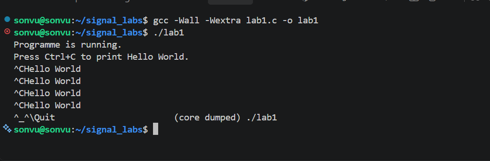
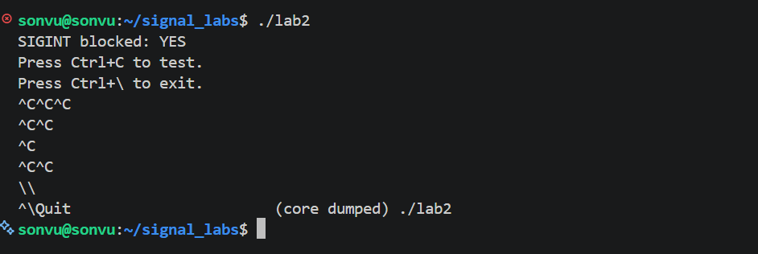
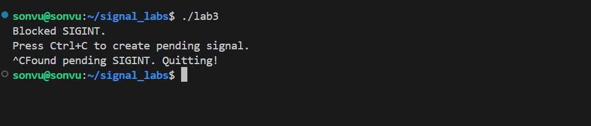
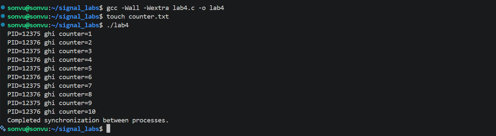

# Linux Signal – Lý thuyết và bài thực hành C

- Người thực hiện : Sơn Vũ 
- Mục tiêu: Bài thực hành giúp tìm hiểu cơ chế **Signal trong Linux**, cách một process nhận và xử lý signal, cách block signal, kiểm tra signal đang pending và sử dụng signal để đồng bộ hai process.

Các chương trình thực hành:

| File | Nội dung |
|---|---|
| `lab1.c` | In `Hello World` mỗi khi nhấn `Ctrl + C` (`SIGINT`) |
| `lab2.c` | Block `SIGINT` và kiểm tra signal mask hiện tại |
| `lab3.c` | Block `SIGINT`, kiểm tra pending và thoát khi phát hiện `SIGINT` pending |
| `lab4.c` | Tạo hai process bằng `fork()` và đồng bộ việc cập nhật counter trong file bằng signal |

## 2. Lý thuyết về Signal

### 2.1. Signal là gì?

Signal là một thông báo bất đồng bộ mà hệ điều hành dùng để báo cho process biết một sự kiện đã xảy ra. Signal thường được xem như một dạng **software interrupt**.

Ví dụ:

- Người dùng nhấn `Ctrl + C` trong terminal: thường gửi `SIGINT` đến process đang chạy ở foreground.
- Chương trình truy cập vùng nhớ không hợp lệ: có thể phát sinh `SIGSEGV`.
- Process con thay đổi trạng thái hoặc kết thúc: process cha có thể nhận `SIGCHLD`.
- Một process hoặc người dùng dùng lệnh `kill` để gửi signal đến process khác.

Thời điểm signal đến thường không được chương trình dự đoán trước. Vì vậy, chương trình có thể đăng ký một hàm xử lý signal (signal handler) hoặc chủ động chờ signal bằng các API phù hợp.

### 2.2. Signal handler

**Signal handler** là hàm được gọi khi một signal được xử lý theo hành vi đã đăng ký.

Ví dụ đăng ký handler cho `SIGINT`:

```c
#include <signal.h>

void sig_handler(int signo)
{
    /* Xu ly signal tai day */
}

int main(void)
{
    signal(SIGINT, sig_handler);
    /* Phan con lai cua chuong trinh */
}
```

Tham số `signo` là số hiệu signal được truyền vào handler. Nếu không sử dụng tham số này, có thể viết `(void)signo;` để thể hiện rõ rằng tham số được cố ý bỏ qua và tránh cảnh báo `-Wunused-parameter`.

Trong handler nên gọi các hàm **async-signal-safe**. Ví dụ, `write()` phù hợp để ghi dữ liệu đơn giản ra file descriptor; không nên gọi `printf()`, `malloc()` hoặc các hàm thư viện không bảo đảm an toàn trong signal handler. Các thao tác phức tạp nên được thực hiện bên ngoài handler.


### 2.3. Hành vi xử lý signal

Một signal có thể được xử lý theo một trong các cách chính:

- **Default action:** hành vi mặc định do hệ điều hành quy định cho signal đó; tùy signal, process có thể kết thúc, dừng hoặc thực hiện hành vi khác.
- **Catch/handle:** chương trình đăng ký hàm handler để xử lý signal.
- **Ignore:** yêu cầu bỏ qua signal bằng `SIG_IGN`.
- **Block:** tạm thời ngăn signal được chuyển đến để xử lý. Signal được block có thể được giữ ở trạng thái pending.

Không phải signal nào cũng bắt hoặc ignore được. Đặc biệt, `SIGKILL` và `SIGSTOP` không thể bị bắt, ignore hoặc block.

### 2.4. Một số signal cơ bản

| Signal | Ý nghĩa thường gặp |
|---|---|
| `SIGCHLD` | Báo process cha về sự thay đổi trạng thái của process con |
| `SIGILL` | Lệnh máy không hợp lệ |
| `SIGINT` | Signal ngắt từ terminal, thường do `Ctrl + C` |
| `SIGKILL` | Yêu cầu kết thúc process ngay; không thể bắt hoặc block |
| `SIGSEGV` | Lỗi truy cập bộ nhớ |
| `SIGUSR1` | Signal dành cho mục đích do ứng dụng quy ước |
| `SIGUSR2` | Signal dành cho mục đích do ứng dụng quy ước |


### 2.5. Gửi signal: `kill()` và `raise()`

Hai API được nhắc đến trong slide:

```c
int kill(pid_t pid, int signo);
int raise(int signo);
```

- `kill(pid, signo)`: gửi signal `signo` đến process hoặc nhóm process được xác định bởi `pid`.
- `raise(signo)`: gửi signal đến chính process đang gọi.
- Lệnh shell `kill` cũng được dùng để gửi signal từ terminal.

Với `kill()`, giá trị `pid` có ý nghĩa quan trọng:

- `pid > 0`: gửi đến process có PID tương ứng.
- `pid == 0`: gửi đến nhóm process hiện tại.
- `pid < -1`: gửi đến nhóm process có ID bằng `-pid`.
- `pid == -1`: gửi đến các process mà người gọi được phép gửi signal, theo quy tắc hệ thống.

Quyền gửi signal phụ thuộc danh tính người dùng và quyền hệ thống. Thông thường, người dùng có thể gửi signal đến process thuộc cùng người dùng; gửi đến process thuộc người dùng khác có thể cần quyền cao hơn.

### 2.6. Signal set, signal mask và `sigprocmask()`

`sigset_t` biểu diễn một tập các signal. Một số hàm thao tác với tập signal:

| Hàm | Tác dụng |
|---|---|
| `sigemptyset(&set)` | Khởi tạo tập rỗng |
| `sigfillset(&set)` | Thêm tất cả signal có thể biểu diễn vào tập |
| `sigaddset(&set, signo)` | Thêm một signal vào tập |
| `sigdelset(&set, signo)` | Xóa một signal khỏi tập |
| `sigismember(&set, signo)` | Kiểm tra signal có nằm trong tập không |

`sigprocmask()` dùng để thay đổi hoặc truy vấn signal mask của luồng gọi:

```c
int sigprocmask(int how, const sigset_t *set, sigset_t *oldset);
```

Các giá trị `how` thường dùng:

- `SIG_BLOCK`: thêm các signal trong `set` vào mask hiện tại.
- `SIG_UNBLOCK`: bỏ các signal trong `set` khỏi mask.
- `SIG_SETMASK`: thay mask hiện tại bằng `set`.

Mask là tập hợp các signal đang bị block. Trong chương trình đa luồng, việc quản lý mask có các quy tắc riêng cho từng luồng; ví dụ trong các lab ở đây, chương trình dùng một luồng chính nên có thể tập trung vào hành vi của luồng đó.

### 2.7. Pending signal và `sigpending()`

Một signal bị block khi được gửi đến có thể ở trạng thái **pending**: signal đã phát sinh nhưng chưa được xử lý.

```c
int sigpending(sigset_t *set);
```

Hàm `sigpending()` lấy tập signal đang pending vào `set`. Có thể kết hợp với `sigismember()` để kiểm tra một signal cụ thể.

Đối với signal thông thường, nhiều lần gửi cùng một loại signal khi nó đã pending không nhất thiết được lưu thành nhiều sự kiện riêng biệt.


---


## 3. Lab 1 – In Hello World khi nhấn Ctrl + C

### 3.1. Yêu cầu

Viết chương trình in `Hello World` mỗi khi người dùng nhấn `Ctrl + C`, thay vì kết thúc ngay theo hành vi mặc định của `SIGINT`.

### 3.2. Biên dịch và chạy

Kết quả thực nghiệm:


Sau khi chạy chương trình, chương trình hiển thị thông báo khởi động và hướng dẫn nhấn Ctrl + C. Mỗi lần nhấn Ctrl + C, chương trình in ra Hello World và tiếp tục hoạt động.

Nhận xét:

- Chương trình đã đăng ký thành công signal handler cho SIGINT thông qua hàm signal().

- Khi người dùng nhấn Ctrl + C, signal SIGINT được gửi đến chương trình và hàm sig_handler() được thực thi.

- Việc sử dụng write() trong signal handler giúp in thông báo mà không cần sử dụng hàm printf() không an toàn trong ngữ cảnh xử lý signal bất đồng bộ.

- Kết quả cho thấy chương trình có thể thay đổi hành vi mặc định của SIGINT bằng cách đăng ký signal handler phù hợp.

---

## 4. Lab 2 – Block SIGINT và kiểm tra signal mask

### 4.1. Yêu cầu

Block signal `SIGINT` để khi nhấn `Ctrl + C`, chương trình không kết thúc ngay; đồng thời kiểm tra `SIGINT` có nằm trong signal mask hiện tại hay không.

### 4.2. Cách triển khai

File: `lab2.c`

1. Tạo tập rỗng bằng `sigemptyset()`.
2. Thêm `SIGINT` bằng `sigaddset()`.
3. Block signal bằng `sigprocmask(SIG_BLOCK, &set, NULL)`.
4. Lấy mask hiện tại và kiểm tra thành viên bằng `sigismember()`.

### 4.3. Biên dịch và chạy
Kết quả thực nghiệm:
Sau khi chạy chương trình , màn hình hiển thị

Khi nhấn Ctrl + C nhiều lần, chương trình không kết thúc. Chương trình chỉ dừng khi người dùng nhấn Ctrl + \.

Nhận xét:

- Chương trình đã sử dụng sigemptyset() và sigaddset() để tạo tập signal chứa SIGINT.
- Hàm sigprocmask() được sử dụng để đưa SIGINT vào signal mask, ngăn signal này được xử lý ngay.
- Kết quả SIGINT blocked: YES xác nhận SIGINT có trong signal mask tại thời điểm kiểm tra.
- Khi nhấn Ctrl + C, signal không làm chương trình kết thúc do đang bị block. Signal có thể được giữ ở trạng thái pending cho đến khi được phép xử lý.
- Ctrl + \ gửi SIGQUIT, không bị block trong chương trình này, nên chương trình kết thúc theo hành động mặc định của signal.

Kết quả minh họa sự khác nhau giữa signal bị block và signal được xử lý bình thường, đồng thời xác nhận cách truy vấn signal mask của process.

## 5. Lab 3 – Block SIGINT, kiểm tra pending rồi thoát

### 5.1. Yêu cầu

Block `SIGINT`, liên tục kiểm tra các signal pending và thoát khi phát hiện `SIGINT` đang pending.

### 5.2. Cách triển khai

File: `lab3.c`

1. Tạo tập chỉ chứa `SIGINT`.
2. Block `SIGINT` bằng `sigprocmask()`.
3. Dùng `sigpending()` để lấy tập pending.
4. Dùng `sigismember()` kiểm tra `SIGINT`.
5. Nếu kết quả bằng `1`, in thông báo rồi thoát khỏi vòng lặp.
6. Nếu chưa có, ngủ một giây trước lần kiểm tra tiếp theo.


### 5.3. Biên dịch và chạy

Kết quả thực nghiệm:

Sau khi chạy, chương trình hiển thị:


Sau khi người dùng nhấn Ctrl + C, chương trình phát hiện SIGINT đang pending và kết thúc.

Nhận xét:

- Chương trình đã block SIGINT trước khi kiểm tra trạng thái signal.
- Hàm sigpending() được sử dụng để lấy tập các signal đang pending.
- Hàm sigismember() kiểm tra xem SIGINT có nằm trong tập pending hay không.
- Khi phát hiện SIGINT pending, chương trình thực hiện nhánh kết thúc theo yêu cầu của bài.
- Kết quả chứng minh rằng signal bị block không nhất thiết bị loại bỏ; signal vẫn có thể được lưu ở trạng thái pending để xử lý sau.

 Chương trình đã minh họa được mối quan hệ giữa signal mask, signal pending và việc kiểm tra trạng thái signal bằng các API của Linux.

---

## 6. Lab 4 – Đồng bộ hai process cùng cập nhật file bằng signal

### 6.1. Yêu cầu

Viết chương trình A tạo process B bằng `fork()`. Cả A và B cùng ghi vào một file. Mỗi lượt, process đọc counter cuối cùng, tăng counter lên một rồi ghi một dòng mới gồm PID của process và counter mới. Hai process phải được đồng bộ bằng signal.

### 6.2. Vì sao cần đồng bộ?

Nếu A và B cùng đọc giá trị counter cũ trước khi bên nào ghi kết quả, cả hai có thể ghi cùng một counter mới. Ví dụ, cả hai cùng đọc `5` rồi cùng ghi `6`. Khi đó counter bị trùng và không tăng tuần tự.

### 6.3. Quy ước signal

Trong `lab4.c`, chương trình dùng hai signal theo quy ước riêng:

- `SIGUSR1`: A báo cho B rằng đã đến lượt B.
- `SIGUSR2`: B báo cho A rằng B đã ghi xong.

Quy trình một lượt:

1. A đọc counter cuối file, tăng lên một và ghi file.
2. A gửi `SIGUSR1` cho B.
3. B nhận signal, đọc counter mới nhất, tăng lên một và ghi file.
4. B gửi `SIGUSR2` về A.
5. A chờ nhận `SIGUSR2` rồi mới bắt đầu lượt tiếp theo.

Chương trình block hai signal trước khi gọi `fork()` và sử dụng `sigwait()` để chờ signal một cách đồng bộ. `fork()` tạo process con; `kill()` gửi signal; `waitpid()` giúp process cha đợi process con kết thúc.

### 6.4. File và định dạng dữ liệu

File dữ liệu: `counter.txt`

Mỗi dòng có dạng:

```text
PID=1234 counter=1
PID=1235 counter=2
PID=1234 counter=3
```

Các PID trên chỉ là ví dụ. PID thực tế phụ thuộc vào lần chạy chương trình.

`read_last_counter()` đọc file từ đầu đến cuối và lấy giá trị counter cuối cùng hợp lệ. `append_record()` mở file với chế độ nối thêm (`"a"`) và ghi một dòng mới.

### 6.5. Biên dịch và chạy

Kết quả thực nghiệm:


Sau khi biên dịch chương trình, tạo file rỗng counter.txt và chạy, màn hình hiển thị các dòng counter tăng liên tiếp từ 1 đến 10. PID của hai process thay phiên nhau xuất hiện:


Các PID trên chỉ là ví dụ từ lần chạy thực tế; PID có thể thay đổi ở lần chạy khác.

Nhận xét:

- Hàm fork() được sử dụng để tạo process con, cho phép process cha và process con thực hiện nhiệm vụ độc lập.

- Hai process cùng thao tác trên file counter.txt.

- Mỗi lượt, process đọc giá trị counter cuối cùng, tăng giá trị lên một đơn vị và ghi thêm bản ghi mới gồm PID và counter.

- Các signal SIGUSR1 và SIGUSR2 được sử dụng để trao đổi thông báo giữa hai process, giúp kiểm soát thứ tự thực hiện thao tác đọc và ghi.

- Kết quả counter tăng lần lượt từ 1 đến 10, không có giá trị trùng lặp trong phần kết quả hiển thị.

- Thông báo Completed synchronization between processes. cho thấy chương trình đã hoàn thành các lượt thực hiện và kết thúc theo luồng điều khiển được thiết kế.

 Chương trình minh họa cách dùng signal để đồng bộ hai process khi cùng cập nhật dữ liệu trong một file, hạn chế tình trạng hai process cùng đọc một giá trị cũ và ghi ra counter trùng nhau.

